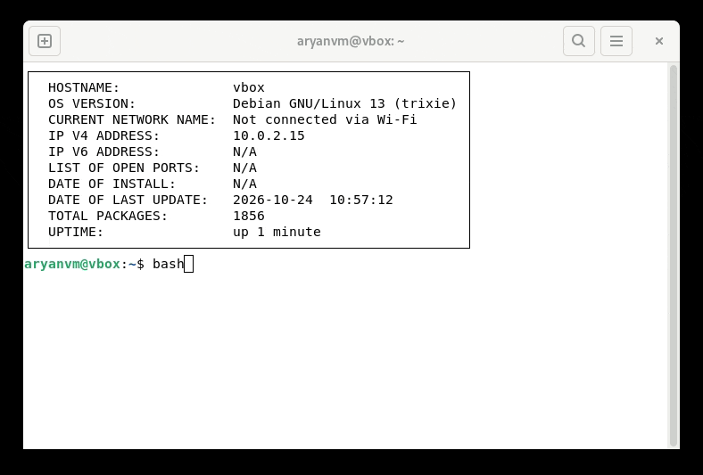
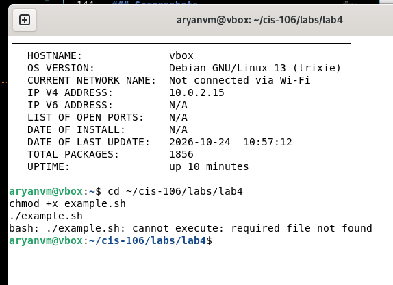
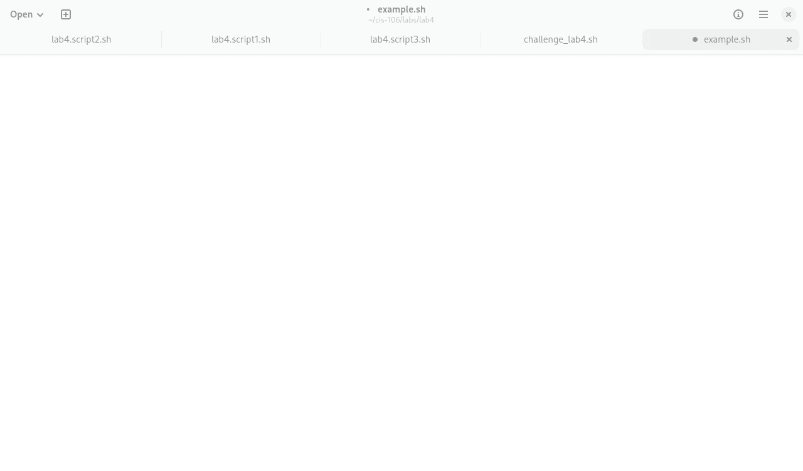

# Notes 4

## 1. How to Install and Remove Software Using APT

APT (Advanced Package Tool) is used in Linux to install, update, and remove software using the terminal.

### Step 1: Open the Terminal

Open the terminal in Linux by pressing `Ctrl + Alt + T`.

### Step 2: Update the Package List

Before installing software, update the package list.

```bash
sudo apt update
```

This command updates the list of available software packages.

### Step 3: Install Software

To install software, use the `apt install` command.

**Example 1: Install Tree**

```bash
sudo apt install tree
```

The `tree` command displays files and folders in a tree structure.

**Example 2: Install Htop**

```bash
sudo apt install htop
```

Htop is used to view running processes and system performance.

**Example 3: Install Curl**

```bash
sudo apt install curl
```

Curl is used to transfer data from websites and servers.

### Step 4: Remove Software

To remove installed software, use the `apt remove` command.

```bash
sudo apt remove tree
```

This removes the Tree program from Linux.

### Step 5: Remove Software Completely

```bash
sudo apt purge tree
```

This removes the program and its system configuration files.

### Step 6: Remove Unused Packages

```bash
sudo apt autoremove
```

This removes dependencies that are no longer needed.

---

## 2. How to Create and Run a Shell Script

A shell script is a text file that contains Linux commands. It allows us to run multiple commands together.

### Step 1: Create a Shell Script

Open the **Text Editor** in Linux and create a new file.

Save the file with a `.sh` extension.

For example:

`myscript.sh`

### Step 2: Add the Shell Declaration

At the beginning of the file, type:

```bash
#!/bin/bash
```

This tells Linux to use the Bash shell to run the script.

### Step 3: Add Your Code

Below the shell declaration, write the commands you want to run.

Example:

```bash
#!/bin/bash

echo "Hello Linux"
echo "Today's date is:"
date
echo "Current user:"
whoami
echo "Current directory:"
pwd
```

- `echo` displays a message.
- `date` shows the current date and time.
- `whoami` shows the current username.
- `pwd` shows the current directory.

After writing the code, save the file in the Text Editor.

### Step 4: Run the Shell Script

Open the terminal in the folder where the script was saved.

First, give the script permission to run:

```bash
chmod +x myscript.sh
```

Then run the script:

```bash
./myscript.sh
```

The terminal will display the message, current date, username, and directory.

### Screenshots

**Screenshot 1: My shell script in the Text Editor**



**Screenshot 2: Giving execute permission in the terminal**



**Screenshot 3: Running the shell script**


